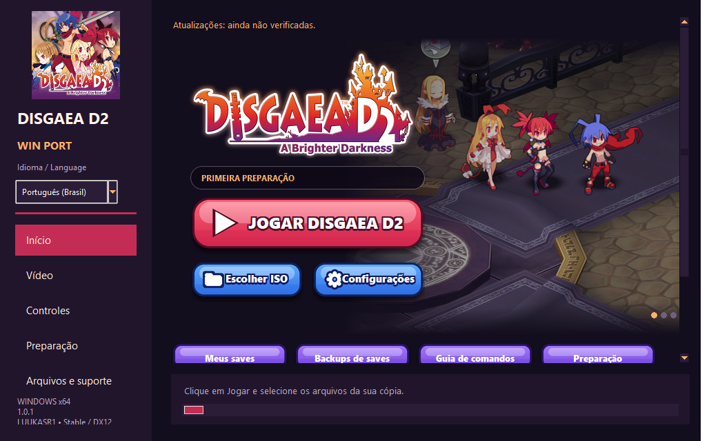

# Disgaea D2 Windows 1.0.1 — Stable / DirectX 12

## Português

Atualização visual do launcher sobre a 1.0.0. O jogo em si não mudou.

### O que mudou

- **Nova tela inicial** inspirada em launchers de jogo: banner grande com capturas do Disgaea D2 em rotação, título
  **DISGAEA D2 · A BRIGHTER DARKNESS**, botão **JOGAR** em destaque e atalhos em blocos (ISO, vídeo, saves, backups,
  guia de comandos e preparação).
- Mantidos o seletor de ISO em vidro, o idioma Português/English e todos os atalhos da 1.0.0.
- Todo o conteúdo da [1.0.0](RELEASE-1.0.0.md) continua valendo (menu F1, filtros, HDR, contorno, capturas, avisos etc.).

### Atualizar

Feche o jogo e o launcher, execute `DisgaeaD2Launcher-Setup-Windows-x64.exe` (ou use o ZIP portátil) e abra normalmente.
Saves e configurações ficam em `%LOCALAPPDATA%\DisgaeaD2Recomp-Graphics-Preview`. Como o jogo não mudou, a build local já
preparada na 1.0.0 continua válida.

As imagens do banner são capturas de tela do próprio jogo (apresentação); nenhum arquivo do jogo é distribuído.
Projeto comunitário independente. Veja os limites e a validação em [RELEASE-1.0.0.md](RELEASE-1.0.0.md).

## English

Launcher visual update on top of 1.0.0. The game itself did not change.

### What changed

- **New home screen** inspired by game launchers: a large banner rotating Disgaea D2 screenshots, the
  **DISGAEA D2 · A BRIGHTER DARKNESS** title, a prominent **PLAY** button and tile shortcuts (ISO, video, saves, backups,
  command guide and setup).
- The glass ISO picker, Português/English language and every 1.0.0 shortcut are kept.
- Everything in [1.0.0](RELEASE-1.0.0.md) still applies (F1 menu, filters, HDR, outline, screenshots, notices, etc.).

### Updating

Close the game and launcher, run `DisgaeaD2Launcher-Setup-Windows-x64.exe` (or use the portable ZIP) and open it as usual.
Saves and settings stay in `%LOCALAPPDATA%\DisgaeaD2Recomp-Graphics-Preview`. Since the game did not change, the local
build prepared with 1.0.0 stays valid.

The banner images are screenshots of the game itself (presentation only); no game files are distributed.
Independent community project. See limits and validation in [RELEASE-1.0.0.md](RELEASE-1.0.0.md).
