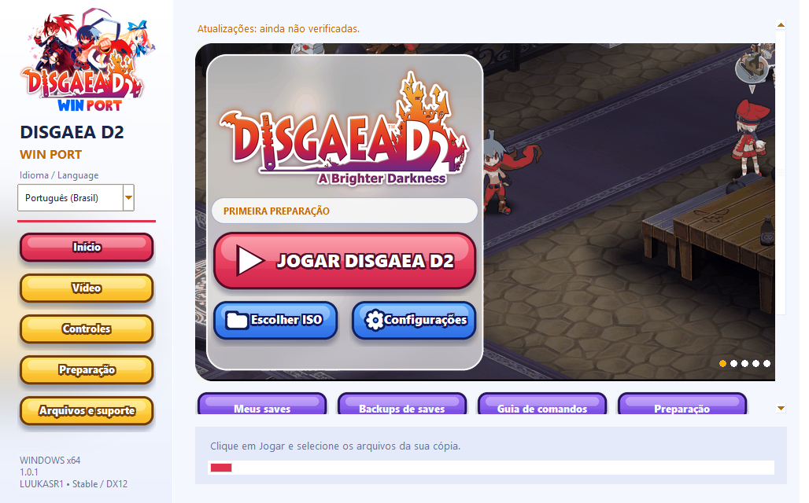

# Disgaea D2 Windows 1.0.2 — Stable / DirectX 12

## Português

Novo visual do launcher sobre a 1.0.1. O jogo em si não mudou.

### O que mudou

- **Tema claro com aspecto de vidro**: menu lateral e banner com vidro fosco.
- **Menu lateral cartoon**: botões amarelos que ficam vermelhos na página aberta.
- **Novo logo Disgaea D2 Win Port** no topo do menu lateral.
- **Carrossel com 5 capturas de gameplay** (troca sozinho; os pontinhos são clicáveis).
- Mantidos o botão JOGAR, Escolher ISO, Configurações, o seletor de ISO em vidro e o idioma Português/English.
- Todo o conteúdo da [1.0.0](RELEASE-1.0.0.md) continua valendo.

### Atualizar

Feche o jogo e o launcher, execute `DisgaeaD2Launcher-Setup-Windows-x64.exe` (ou use o ZIP portátil) e abra normalmente.
Saves e configurações ficam em `%LOCALAPPDATA%\DisgaeaD2Recomp-Graphics-Preview`. A build local preparada na 1.0.0 continua válida.

As imagens do banner são capturas de tela do próprio jogo; nenhum arquivo do jogo é distribuído.
Projeto comunitário independente. Veja os limites e a validação em [RELEASE-1.0.0.md](RELEASE-1.0.0.md).

## English

Launcher visual update on top of 1.0.1. The game itself did not change.

### What changed

- **Light, glass-style theme**: frosted-glass side menu and banner.
- **Cartoon side menu**: yellow buttons that turn red on the open page.
- **New Disgaea D2 Win Port logo** above the side menu.
- **Gameplay carousel with 5 screenshots** (auto-rotates; the dots are clickable).
- The PLAY button, Choose ISO, Settings, the glass ISO picker and Português/English are kept.
- Everything in [1.0.0](RELEASE-1.0.0.md) still applies.

### Updating

Close the game and launcher, run `DisgaeaD2Launcher-Setup-Windows-x64.exe` (or use the portable ZIP) and open it as usual.
Saves and settings stay in `%LOCALAPPDATA%\DisgaeaD2Recomp-Graphics-Preview`. The local build prepared on 1.0.0 is still valid.

Banner images are screenshots of the game itself; no game files are distributed. Independent community project.
