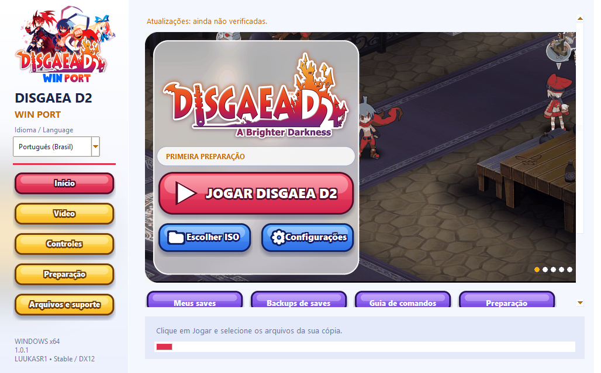
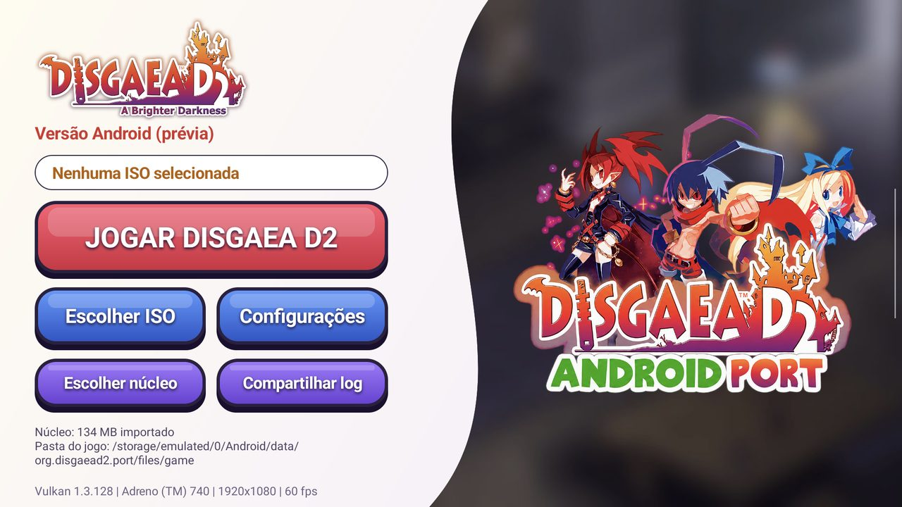
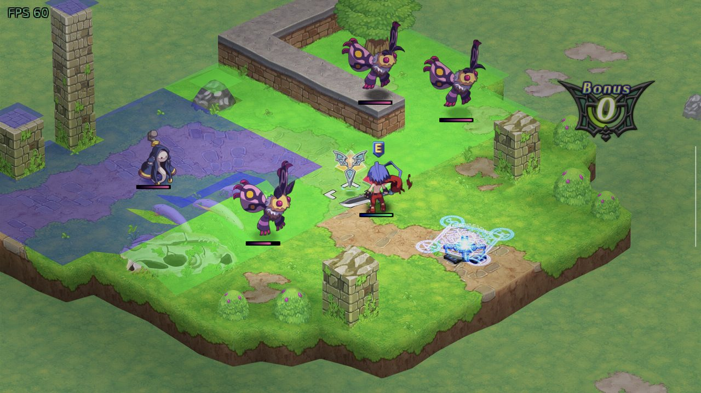
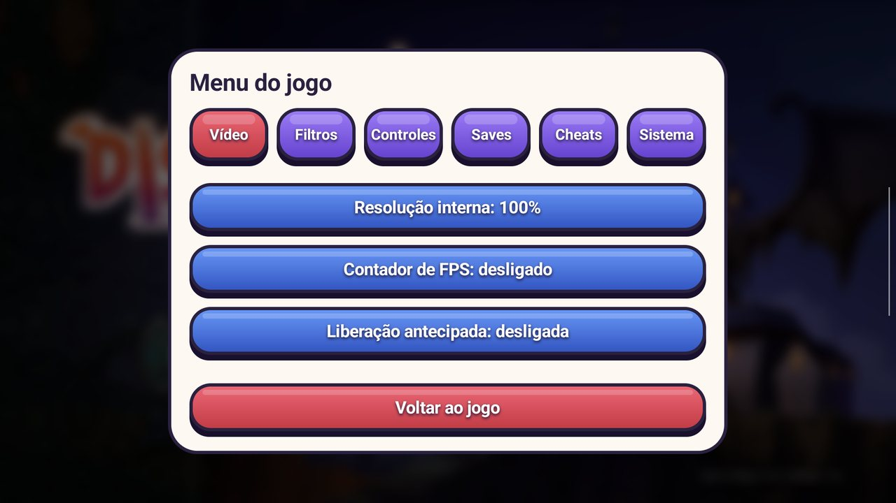
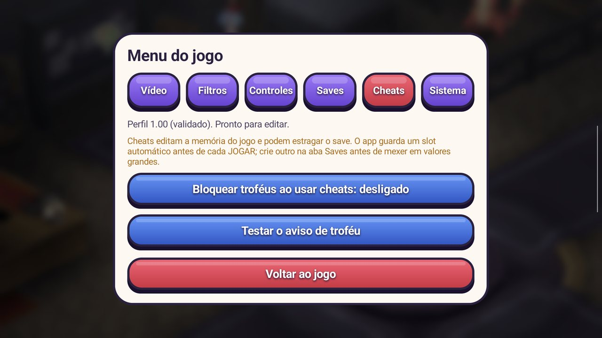

# Disgaea D2 Recomp 1.0.53 — Windows e Android

Lançamento oficial do projeto comunitário que roda **Disgaea D2: A Brighter Darkness (PS3)** recompilado, agora no **Windows** (DirectX 12) **e no Android** (Vulkan). É uma **adição** ao que já existia: tudo da [1.0.0](RELEASE-1.0.0.md) e da [1.0.2](RELEASE-1.0.2.md) continua valendo, e o launcher atualiza por cima da instalação atual sem apagar saves nem configurações.

> **Projeto em melhoria contínua.** Ainda estamos melhorando o jogo, o launcher e o app Android todos os dias. **Qualquer ajuda é bem-vinda**: testes em outros aparelhos e versões do jogo, relatórios de erro (com o log), capturas de tela, tradução e código. Abra uma *issue* ou um *pull request* neste repositório.

**Nenhum arquivo do jogo, atualização, firmware, chave, save ou código compilado do jogo é distribuído.** Você precisa da sua própria cópia do jogo. Projeto independente, sem vínculo com os detentores dos direitos.

## Novidades da 1.0.53 (Windows)

- **Cheats e editor de personagens dentro do menu F1 do jogo**, tudo numa janela só: o menu de opções (Vídeo, Filtros, Teclas, Sistema) ganhou as abas **Cheats** (HP/SP infinito, dano máximo, loja grátis, multiplicador de EXP, valores gerais, presets e a **trava de troféus**) e **Personagens** (editor por personagem). Clique = +, botão direito = −, Shift ×10, Ctrl ×100, Shift+Ctrl = máx./mín.; a roda do mouse também funciona.
- **Menu pelo controle:** **Start + Select** abre e fecha o menu F1. Com ele aberto: direcional move, esquerda/direita mudam o valor, **A** seleciona, **B** fecha e **LB/RB** trocam de aba.
- **O jogo pausa com o menu F1 aberto** (antes continuava se mexendo ao fundo) e volta ao fechar. Na aba **Sistema** há botões para **testar o aviso de troféu** (conquistado / bloqueado) sem gravar nenhum troféu; o aviso aparece no launcher aberto.
- **Aviso de troféu no estilo PlayStation** sobre a janela do jogo, com a taça (bronze, prata, ouro ou platina), o nome e o ícone original quando o launcher acha o `TROPHY.TRP` da sua pasta do jogo ou da sua ISO.
- **Como usar:** abra o jogo pelo launcher (para ver o aviso de troféu, deixe o launcher aberto). Depois de atualizar, use **Preparar** uma vez para recompilar o jogo (o executável do jogo ganhou o canal usado por essa janela). O jogo precisa estar em janela ou tela cheia sem bordas para o aviso aparecer por cima.
- Rótulos de "prévia" removidos da versão europeia e do núcleo Android no launcher.

## Versões do jogo e plataformas

| Versão do jogo | Windows | Android |
|---|---|---|
| **EUA** BLUS31313 1.40 | Funciona (base do projeto desde a 1.0) | Ainda não testada no aparelho |
| **Europa** BLES01939 1.00 | Funciona (testada) | Funciona (testada no AYN Odin 2 Portal, do título às batalhas) |
| **Japão** BLJS10206 1.30 | Suporte contribuído por DesertDoggy; testado até o primeiro mapa, o resto da campanha não foi validado | Compila pelo launcher, ainda não testada no aparelho |

## Windows

- Launcher em vidro com tema claro, perfis separados para **EUA, Europa e Japão** (**Arquivos e suporte**), saves e slots, cheats, filtros de imagem e FSR.
- **Instalação:** baixe `DisgaeaD2Launcher-Setup-Windows-x64.exe` (ou o ZIP portátil / o `.exe` avulso), abra o launcher e escolha **a sua** ISO ou pasta do jogo. A primeira preparação compila o jogo no seu PC (precisa de internet e pode demorar).
- **Atualizar a partir da 1.0.x:** feche o jogo, execute o instalador por cima. Saves e configurações ficam em `%LOCALAPPDATA%\DisgaeaD2Recomp-Graphics-Preview`.
- Versão europeia: escolha a pasta do jogo (PS3_GAME) ou a ISO e o EBOOT.elf descriptografado. Versão japonesa: pasta do disco e as três atualizações (1.10, 1.20 e 1.30).

## Android

- App para **ARM64 com Vulkan**, testado no **AYN Odin 2 Portal** (Adreno 740), normalmente entre 30 e 60 fps. Idiomas do app: **English (padrão), Português, 日本語 e Español**, escolhidos na tela inicial.
- **Como instalar:** (1) no launcher do Windows, em **Arquivos e suporte → Preparar núcleo Android**, gere o `libd2core.so` a partir do **seu** jogo (baixa o NDK na primeira vez); (2) instale o APK `Disgaea D2-Android-0.10.1.apk`; (3) copie a pasta do jogo (com `PS3_GAME`) para `Android/data/org.disgaead2.port/files/game`; (4) no app, **Escolher núcleo** e selecione o `libd2core.so`; (5) **JOGAR**.
- Menu do jogo (**L3 + R3** ou botão Voltar) com abas Vídeo, Filtros, Controles, Saves, Cheats e Sistema; controles na tela; saves e slots (importa saves do PC); cheats e editor de personagens; aviso de troféu no estilo PlayStation com nome e ícone originais, resetar e travar troféus.

## Limitações conhecidas

- O Android foi validado em **um** aparelho e na versão europeia; outros aparelhos, a versão americana e a japonesa podem ter problemas.
- A japonesa foi testada só até o primeiro mapa. A preparação é demorada porque o jogo é compilado no seu computador.
- No Android, os nomes dos troféus aparecem em inglês.

## Verificação

Os hashes SHA-256 estão em `SHA256SUMS.txt` (Windows) e `SHA256SUMS-Android.txt` (APK).

---

# Disgaea D2 Recomp 1.0.53 — Windows and Android

Official release of the community project that runs a recompiled **Disgaea D2: A Brighter Darkness (PS3)** on **Windows** (DirectX 12) **and Android** (Vulkan). It is an **addition** to what already exists: everything in [1.0.0](RELEASE-1.0.0.md) and [1.0.2](RELEASE-1.0.2.md) still applies, and the launcher updates over your current install keeping saves and settings.

> **Work in progress.** We keep improving the game, the launcher and the Android app. **Any help is welcome**: testing on other devices and game versions, bug reports (with logs), screenshots, translations and code. Open an issue or a pull request in this repository.

**No game files, updates, firmware, keys, saves or compiled game code are distributed.** You need your own copy of the game. Independent project, not affiliated with the rights holders.

## What's new in 1.0.53 (Windows)

- **Cheats and character editor inside the game's F1 menu**, all in one window: the options menu (Video, Filters, Keys, System) gained **Cheats** (infinite HP/SP, maximum damage, free shop, EXP multiplier, general values, presets and the **trophy lock**) and **Characters** (per-character editor) tabs. Click = +, right click = −, Shift ×10, Ctrl ×100, Shift+Ctrl = max/min; the mouse wheel works too.
- **Menu from the controller:** **Start + Select** opens and closes the F1 menu. While open: D-pad moves, left/right change a value, **A** selects, **B** closes and **LB/RB** switch tabs.
- **The game pauses while the F1 menu is open** (it used to keep running behind it) and resumes on close. The **System** tab has buttons to **test the trophy pop-up** (earned / blocked) without recording any trophy; the pop-up shows from the open launcher.
- **PlayStation-style trophy pop-up** over the game window, with the cup (bronze, silver, gold or platinum), the name and the original icon when the launcher finds `TROPHY.TRP` in your game folder or ISO.
- **How to use:** start the game from the launcher (keep the launcher open to see the trophy pop-up). After updating, run **Prepare** once to rebuild the game (the game executable gained the channel this window uses). The game must be windowed or borderless for the pop-up to show on top.

## Game versions and platforms

| Game version | Windows | Android |
|---|---|---|
| **US** BLUS31313 1.40 | Works (the project's base since 1.0) | Not tested on a device yet |
| **Europe** BLES01939 1.00 | Works (tested) | Works (tested on the AYN Odin 2 Portal, title screen to battles) |
| **Japan** BLJS10206 1.30 | Contributed by DesertDoggy; tested up to the first map, the rest of the campaign is not validated | Builds through the launcher, not tested on a device yet |

## Windows

Run `DisgaeaD2Launcher-Setup-Windows-x64.exe` (or use the portable ZIP / single `.exe`), open the launcher and pick **your** ISO or game folder; the first preparation builds the game on your PC (internet required, can take a while). The launcher keeps separate US, European and Japanese profiles under **Files and support**.

## Android

ARM64 + Vulkan, tested on the AYN Odin 2 Portal. App languages: **English (default), Português, 日本語, Español**, chosen on the home screen. Steps: build `libd2core.so` from your own game with the Windows launcher (**Files and support → Prepare Android core**), install `Disgaea D2-Android-0.10.1.apk`, copy your game folder (with `PS3_GAME`) to `Android/data/org.disgaead2.port/files/game`, pick the core in the app and press PLAY. Includes an in-game menu (L3 + R3), on-screen controls, save slots, cheats, and PlayStation-style trophy banners.

## Known limitations

Android is validated on one device and on the European version only; the US and Japanese versions on Android may have problems. The Japanese version was tested only up to the first map. Trophy names are shown in English on Android.
