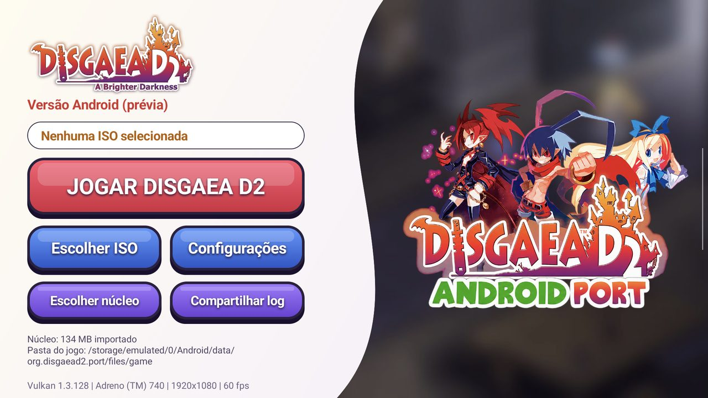
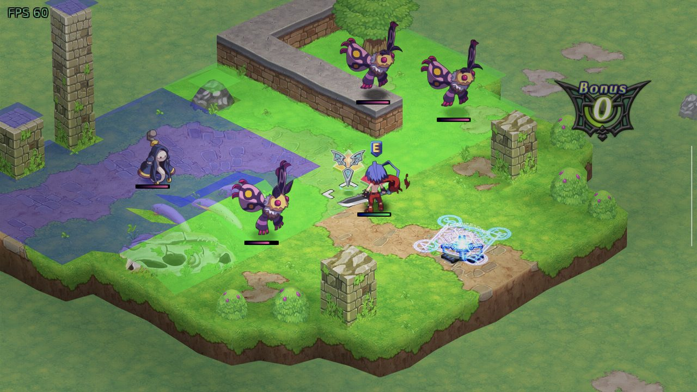
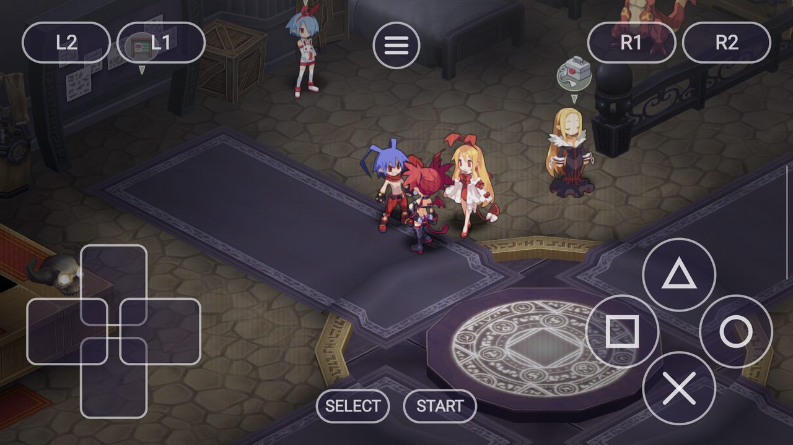
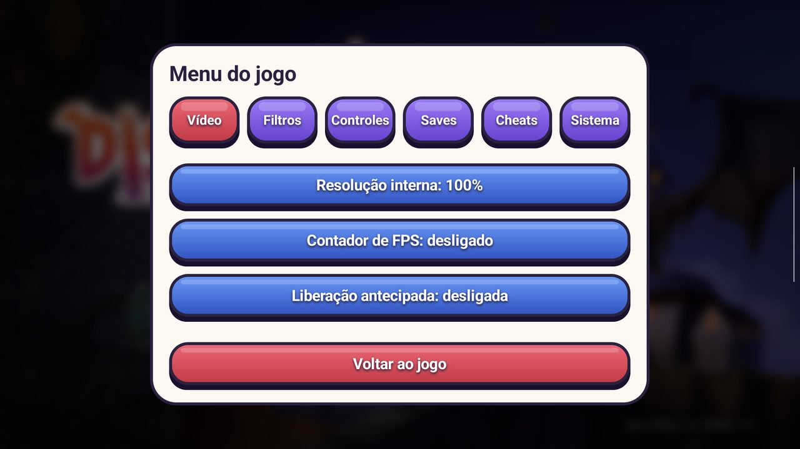
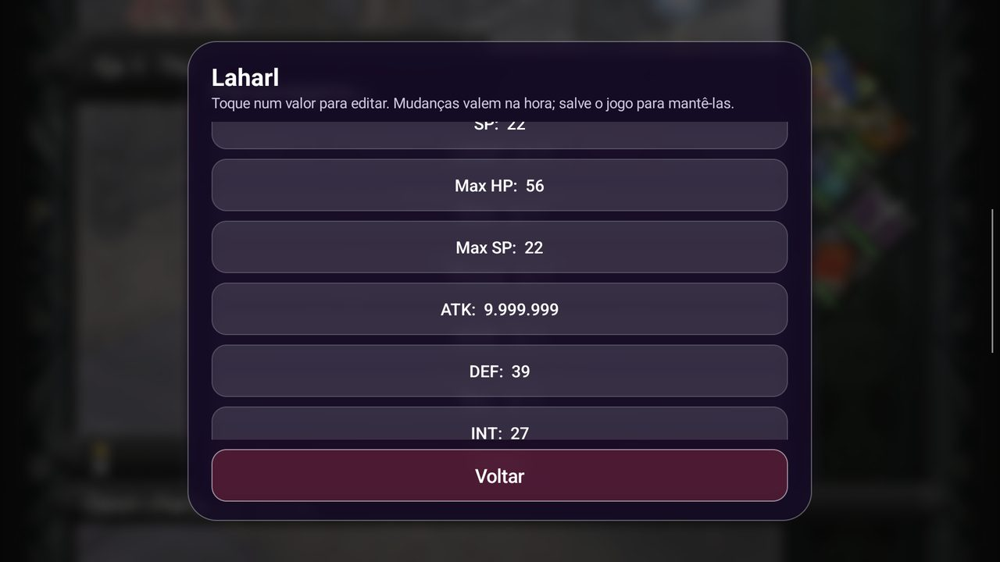
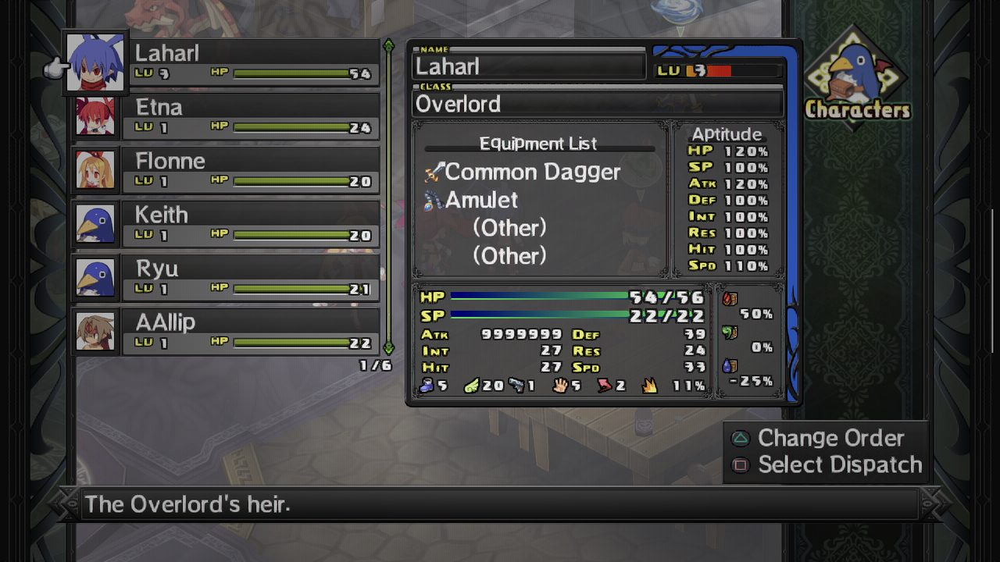

# Disgaea D2 Android 0.9.3 — prévia pública (experimental)

Porte **experimental** de Disgaea D2: A Brighter Darkness (PS3) para Android, feito sobre o mesmo projeto do launcher do Windows. Testado no **AYN Odin 2 Portal** (Adreno 740) com a **versão europeia (BLES01939, 1.00)**: o jogo roda da tela de título até as batalhas, normalmente entre 30 e 60 fps. Pode ter defeitos; relate o que encontrar.

**Nenhum arquivo do jogo, atualização, firmware, chave ou código compilado do jogo é distribuído.** Você precisa da sua própria cópia do jogo. Projeto independente da comunidade, não é um lançamento oficial dos detentores dos direitos.

## Requisitos

- Android 10 ou mais novo, processador **ARM64** e GPU com **Vulkan** (testado só no Odin 2 Portal).
- Um PC com Windows e o **launcher 1.0.51 (prévia)** ou mais novo, com o seu jogo já preparado nele, para gerar o núcleo do jogo (`libd2core.so`, cerca de 134 MB) a partir dos **seus** arquivos.
- A pasta do jogo preparada no PC (a que contém `PS3_GAME/USRDIR/EBOOT.elf`).

## Como instalar

1. No launcher do Windows, em **Arquivos e suporte**, toque em **Preparar núcleo Android (prévia)**. Na primeira vez ele baixa o NDK (cerca de 750 MB) e compila o núcleo; o arquivo `libd2core.so` fica pronto no fim.
2. Instale o APK **Disgaea D2-Android-0.9.3** no aparelho (pode ser preciso permitir "instalar apps desconhecidos").
3. Copie a pasta do jogo para `Android/data/org.disgaead2.port/files/game` (a pasta `PS3_GAME` fica dentro de `game`).
4. No app, toque em **Escolher núcleo** e selecione o `libd2core.so`.
5. Toque em **JOGAR DISGAEA D2**.

Se o aparelho for atualizado depois por uma nova versão do app, gere de novo o núcleo só quando as notas disserem que ele mudou.

## Novidades

- **Menu do jogo** (botão Voltar ou **L3 + R3**) no mesmo visual da tela inicial, com abas **Vídeo, Filtros, Controles, Saves, Cheats e Sistema**.
- **Controles na tela** (direcional ou analógico, ✕ ○ □ △, L1/L2/R1/R2, Start/Select, analógico direito opcional), com tamanho, opacidade e vibração ajustáveis. Somem sozinhos quando há um controle físico conectado.
- **Saves e slots**: salvar o save atual num slot com nome, importar saves do PC (pasta ou .zip), carregar, exportar e apagar. Carregar nunca perde o save atual, e há backup automático antes de cada partida.
- **Cheats e editor de personagens** (HP, SP, EXP, loja grátis, valores gerais e de cada personagem do grupo).
- **Troféus**: aviso na tela no estilo PlayStation, com a taça do tipo (bronze, prata, ouro ou platina), o nome do troféu e o ícone original quando você escolhe a ISO do jogo; botão para **resetar os troféus** e, opcionalmente, **bloquear troféus** depois de usar cheats.
- **Vídeo**: resolução interna, contador de FPS, liberação antecipada e filtros (nitidez, scanlines, CRT, vinheta, cores vivas, FXAA).
- O relógio e o áudio do jogo pausam em segundo plano, e as texturas do chão não saem mais trocadas depois de minimizar e voltar.

## Limitações conhecidas

- Experimental: desempenho e compatibilidade variam; só foi validado em um aparelho e na versão europeia.
- A versão japonesa (BLJS10206 1.30) compila pelo launcher, mas ainda não foi testada no Android.
- O jogo precisa dos arquivos preparados pelo launcher; este app não lê o jogo direto da ISO (a ISO serve só para pegar os ícones dos troféus).
- Os nomes dos troféus aparecem em inglês.

## Verificação

O APK é assinado com a chave fixa do projeto (a mesma das versões de teste, então instala por cima delas sem perder dados). O hash SHA-256 está em `SHA256SUMS.txt`.

---

**English summary.** Experimental Android port (ARM64, Vulkan) of the community recompilation project, tested on the AYN Odin 2 Portal with the European disc (BLES01939). No game data is distributed: you build the game core from your own copy with the Windows launcher (1.0.51 preview or newer), copy your prepared game folder to `Android/data/org.disgaead2.port/files/game`, pick the core in the app and play. Includes on-screen touch controls, save slots, cheats, a PlayStation-style trophy banner and a glass-style in-game menu. Independent project, not affiliated with or endorsed by the rights holders.
